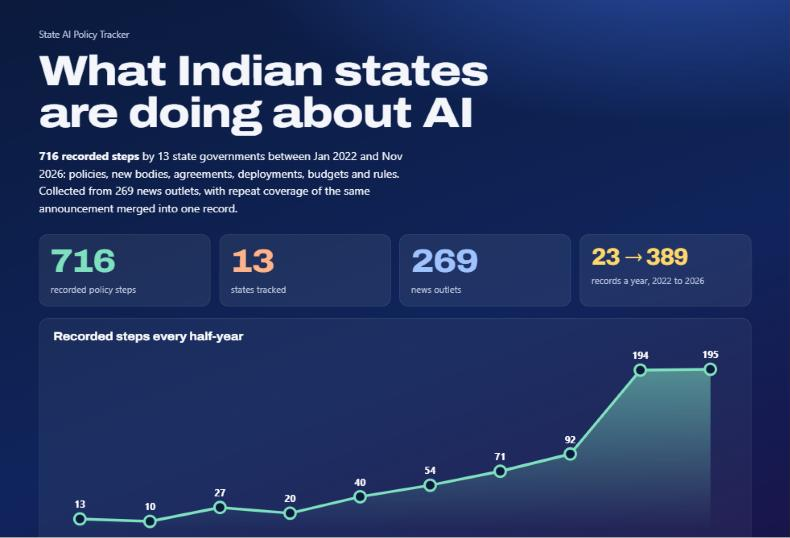
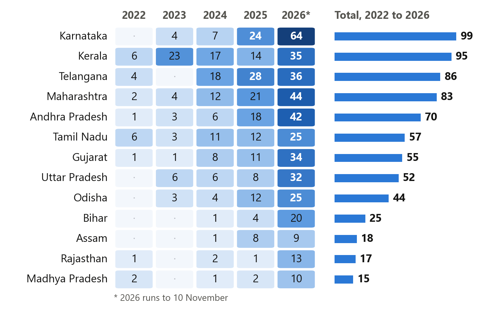
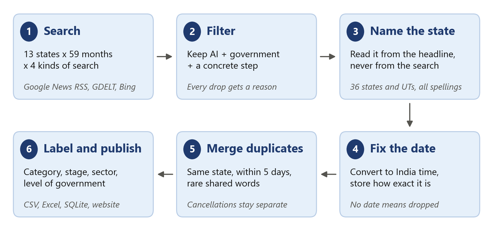
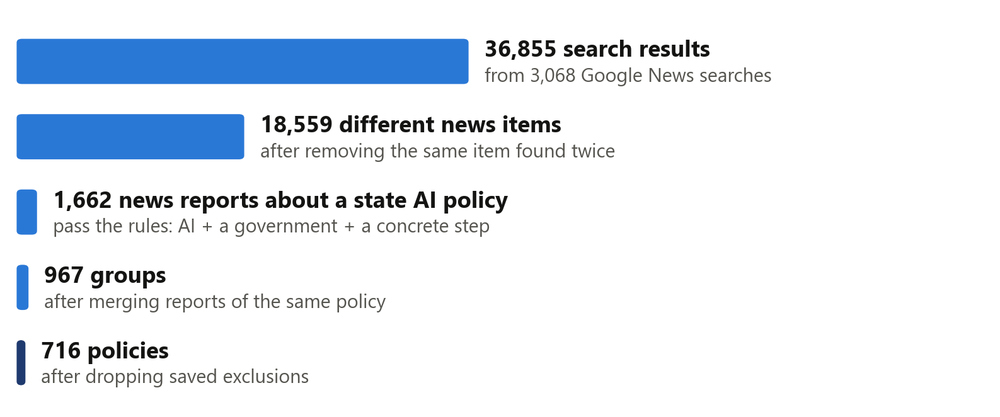
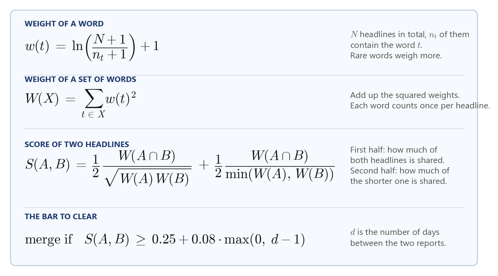
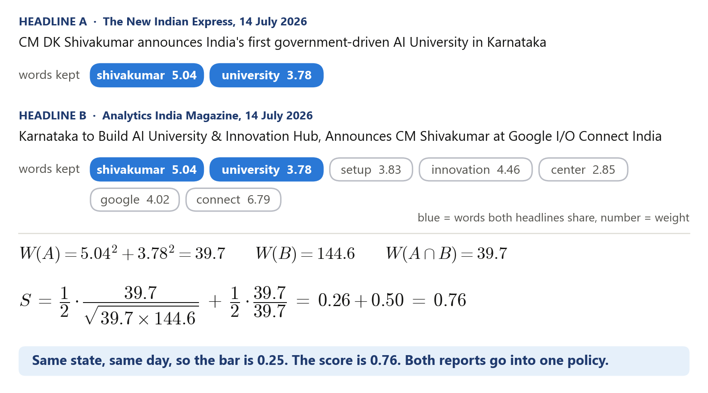
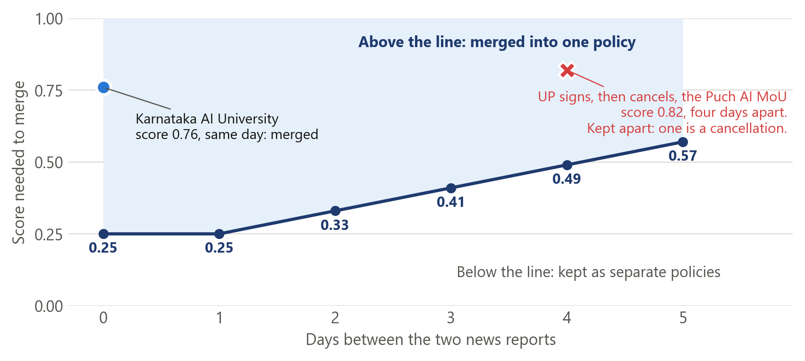
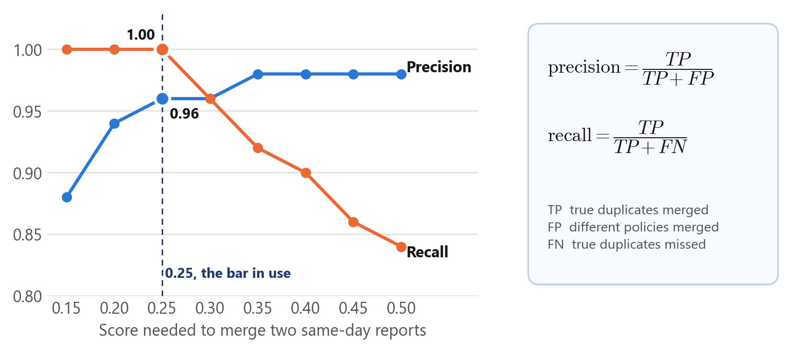

# State AI Policy Tracker

What Indian state governments are doing about AI, collected from news, with every policy traceable to the reports behind it.

**716 policies, 13 states, 1 January 2022 to 10 November 2026.** Behind them are 1,306 news reports. Another 17,253 items were dropped, and each one is saved with the reason.

[Dashboard](https://vishnu0906.github.io/state-ai-policy-tracker/) | [Trend charts](https://vishnu0906.github.io/state-ai-policy-tracker/trends.html) | [Dataset CSV](https://vishnu0906.github.io/state-ai-policy-tracker/data/records.csv) | [Hugging Face](https://huggingface.co/datasets/VKO34/INDIAN-STATE-WISE-AI-POLICY) | [Research notes](https://vishnu0906.github.io/state-ai-policy-tracker/research.html)



## The problem

I built this because so many outlets publish the same news. When I see forty headlines about a state and AI, I do not know if that is forty policies or one policy getting approved. Karnataka's AI University announcement in July 2026 came back 39 times in my searches, each time with a different headline.

The tracker has two goals. The first is to count policies, one row for each, and put them out for public review, so anyone can see which states are being more proactive on AI. The second comes later. Once every policy is on record, I can follow each one: how much of it has been implemented, how far it has progressed, and other measures like the money spent. This release does the first and prepares the ground for the second.

Here a policy means one concrete step by a government that involves AI. It can be a policy document, a new body, a signed agreement, a budget line, a launch or a rule.

Every duplicate has a way to verify it and a clearly stated reason. A report that was merged stays listed under its policy in `record_sources.csv`, with its outlet, date, headline and link. A row removed as a duplicate in review is in `rejected.csv` with the ID of the policy it duplicates. Every other dropped item has its reason there too.

## Where to look first

| I want to | Open |
|---|---|
| See the result | The [dashboard](https://vishnu0906.github.io/state-ai-policy-tracker/), or `data/out/records.xlsx` |
| Read the full report | [SUBMISSION.md](SUBMISSION.md) |
| Know why I made these choices | [RATIONALE.md](RATIONALE.md), one page |
| Check a rule | [METHODOLOGY.md](METHODOLOGY.md) |
| See the last fixes | [RELEASE_NOTES.md](RELEASE_NOTES.md) |

## What is in the data

| File | Rows | What it holds |
|---|---:|---|
| `data/out/records.csv` | 716 | One row per policy |
| `data/out/records.xlsx` | 716 | The same, with a sheet that explains every column and a sheet of dropped items |
| `data/out/record_sources.csv` | 1,306 | Every news report behind each policy, joined on `record_id` |
| `data/out/rejected.csv` | 17,253 | Every dropped item and the reason |
| `data/out/tracker.sqlite` | 3 tables | The same data, for SQL |
| `data/reference/events.csv` | 85 | A separate list of policies collected from official documents |

Each policy has a state, a date, a headline, a one-line summary, a source name and link, a category, how far it got (announced, approved, signed, launched or reversed), a sector and a level of government.

The 85 policies in `data/reference/` follow different rules and overlap with the 716. Please do not add the two numbers. That list is there to show what news tends to miss.



## How it works



**Search.** Google News RSS is the main source. It is free, it needs no key, and it can be searched by state and by month. For each of the 13 states and each of the 59 months I ran four searches: the government itself, policy instruments, public services, and infrastructure and rules. That is 3,068 searches and 36,855 results. None of them reached the 100-result limit, which was my check that a busy month was not being cut off.

**Filter.** A news item stays only if it mentions AI, names a government and reports a concrete step. Opinion pieces, company news with no government in it, party politics and AI crime stories with no policy response are dropped.

**Name the state.** The state is read from the headline, never from the search. The list of names covers all 36 states and union territories, with spellings like UP and Uttar-Pradesh, common misspellings, and short forms like MP that count only next to a government word.

**Fix the date.** Feed timestamps are converted to India time. The date of a policy is the date of its earliest news report. An item with no date is dropped. I never fill in the day I collected it.

**Merge duplicates.** Headlines from the same state, at most five days apart, are scored on the rare words they share. A report of a cancellation never merges with a report that is not one.

**Label and publish.** Category, stage, sector and level of government come from the headline. The output goes to CSV, Excel, SQLite and the website.



### Other sources, and where they stand

| Source | What came back | Where it stands |
|---|---|---|
| GDELT | 896 results | Rate limited on most calls, so its coverage is incomplete |
| Bing News RSS | 172 results | Recent weeks only |
| Publisher pages | Summaries for 676 of the 716 policies | Read locally with trafilatura. The other 40 summaries repeat the headline because the site blocked the read |
| GNews, NewsAPI, NewsData | Nothing yet | The code is written, but I never ran it with a key. I do not count these as sources |

There is also an optional step that asks a language model to check a row. It has never been run and it is switched off in offline mode. Tavily is wired in as an optional fallback for page reading and was not used.

## Run it

You need Python 3.11 or later. Every response from the original run is saved in `data/raw/`, so this needs no API key and no network.

```powershell
python -m venv .venv
.venv\Scripts\Activate.ps1
python -m pip install -r requirements.txt
python -m pytest -q
$env:PIPELINE_OFFLINE = "1"
python -m pipeline.collect
python -m pipeline.build
python -m scripts.validate_release
python -m http.server 8790 --directory docs
```

On bash, use `source .venv/bin/activate` and `export PIPELINE_OFFLINE=1`. Then open `http://localhost:8790`.

The rebuild gives the same rows and values in the CSV files. The Excel and SQLite files can differ byte for byte, so compare their contents. To collect fresh news, clear `PIPELINE_OFFLINE`. The dates of the window are in `pipeline/config.py`.

## How duplicates are matched



A real pair from the dataset, two of the 39 reports on the Karnataka AI University:



The bar goes up as two reports get further apart in time. The Uttar Pradesh story below is why the cancellation rule exists. The signing and the cancellation of the Puch AI MoU score 0.82, well above the bar, and only that rule keeps them apart.



The full rules, with the list of words that count as a cancellation, are in [METHODOLOGY.md](METHODOLOGY.md) and `pipeline/dedupe.py`.

## What I checked

| Check | Result | What it tells me |
|---|---|---|
| Automated tests | 97 pass | The rules do what I wrote them to do. They cannot tell me whether a news article is true |
| Rebuild from the saved files | Same rows and values in the CSV files | Anyone can reproduce the dataset |
| 140 labelled headline pairs | 136 found in the data. Precision 0.96, recall 1.00 at a bar of 0.25 | Useful for tuning. It is not an independent score |
| Screening of headlines | 545 policies screened, 171 not | The 171 are mostly from 2022 to 2024 |



## Assumptions and known holes

I would rather list these here than have someone find them later.

- **A row is a reported step.** It tells you what the news said. It does not tell you the policy was delivered, funded or used. Check the source before making a claim about spending or results.
- **English news only.** A state with a small count may be covered more in Hindi, Telugu or Odia papers that I did not search. A bigger count does not mean a better AI policy.
- **The date is the news date.** It is the earliest report I found, in India time. The government order may be dated earlier.
- **The screening was done with an AI assistant.** It went through the headlines, marked the ones that did not belong and labelled the duplicate pairs. I did not open and read every article. In the data, `legacy_headline_screen` marks the 545 screened policies and `auto` marks the 171 that only went through the rules.
- **The unscreened years are noisier.** Kerala has 23 policies in 2023 and 20 of them are about one project, the AI traffic cameras. Some of those rows are follow-up stories.
- **0.96 is a development number.** The labelled pairs were also used to set the bar, and 31 headlines appear in both halves of the check.
- **Duplicates can still slip.** A running story can chain into one policy. A report that comes more than five days later stays separate. Two similar announcements from one state in the same week can merge.
- **Government deployment is the default category.** It has 317 policies, partly because the rules place a policy there when nothing else fits.
- **Older news is harder to find.** The count rises from 23 in 2022 to 389 in 2026. Part of that is real and part is the search index.
- **Supporting links.** Every policy links straight to the publisher. In `record_sources.csv`, 1,206 of the 1,306 links still go through a Google News redirect.
- **IDs can change.** A record ID is built from the earliest report. If an earlier report is found later, the ID changes.
- **An older coverage check.** On the 2025 to 2026 data, the tracker had found 37 of 66 policies from the official-document list. Gazette notices, tenders and budget lines were the main misses. That check has not been repeated on the current data.
- **Central government.** Seven policies are central government steps that name a state. They are labelled `central`, so leave them out when you only want state governments.

## Repository map

```text
pipeline/       search, state and date rules, duplicate matching, page reading, export
scripts/        checks, figures and release material
tests/          cases for states, dates, the filter, and release checks
data/raw/       saved search responses and short page extracts
data/review/    saved exclusions and the labelled pairs
data/out/       the published dataset
data/reference/ the separate list of 85 policies from official documents
docs/           the dashboard, the trend charts and the research page (GitHub Pages)
research/       findings and notes on source options
reports/        counts, check outputs and the report source
```

## Weekly collection

GitHub Pages serves `docs/`. A weekly workflow collects the last 14 days of news into an artifact for review. It does not change the published dataset by itself. New rows go in only after someone has looked at them and committed them. If API keys are added later, they belong in repository secrets and never in files.

## Rights

Headlines, excerpts and source pages belong to their publishers. This repository does not grant a new licence to that material. No credentials or private files are included.
