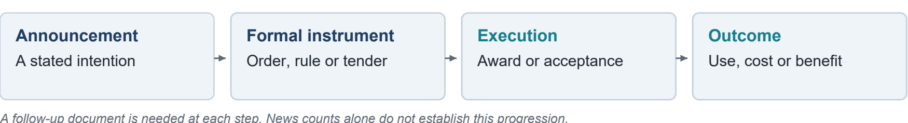

# Work Test Submission SAFL Vishnu Kosuri

## State AI Policy Tracker

A traceable collection of reported government policies across thirteen Indian states.<br/>Research window: 1 January 2022 to 10 November 2026.

I built this around a simple question: when five headlines describe an AI announcement, what should count as one record? The tracker keeps the reports behind each record, explains the rules used to group them, and records what was dropped. It contains <b>716 records, 1,306 contributing reports and 17,253 excluded items with reasons</b>.

![Figure 1. The live dashboard [1]](docs/figures/report/dashboard.png)
Figure 1. The live dashboard [1]

An announcement, a signed agreement and a working public service need different evidence. The tracker labels the reported stage; it does not verify delivery, spending or benefit. Seven central-government actions, 22 judiciary actions and seven local actions are labelled separately from 680 state-government records.

[Dashboard](https://vishnu0906.github.io/state-ai-policy-tracker/) | [Trend charts](https://vishnu0906.github.io/state-ai-policy-tracker/trends.html) | [GitHub repository](https://github.com/VISHNU0906/state-ai-policy-tracker) | [Hugging Face dataset](https://huggingface.co/datasets/VKO34/INDIAN-STATE-WISE-AI-POLICY) | [Dataset CSV](https://vishnu0906.github.io/state-ai-policy-tracker/data/records.csv) | [Submission folder](https://drive.google.com/drive/folders/1eiXw9zKOpTp3EN4HnGmL0P7h-ZHP8095)

## What the collection shows

The same initial query was run across all 28 states. The selection used that discovery volume and geographical spread. Andhra Pradesh, Madhya Pradesh and Rajasthan were added for comparison with a separate document-led reference collection. These thirteen states are a deliberate sample, not a representative sample or a league table.

![Figure 2. Records by state and report year [2]](docs/figures/report/coverage.png)
Figure 2. Records by state and report year [2]

### The useful findings

Karnataka has 99 retained records, Kerala 95 and Telangana 86. Those counts tell me where this collection found more reportable material. They also depend on English-language reporting, search indexing and the rules used to retain a headline. A small count cannot establish that a state did little.

The annual count rises from 23 in 2022 to 389 in 2026 through 10 November. Older search coverage and different screening coverage make a policy-growth estimate unsupported. The year chart is useful for finding periods to inspect, not for measuring a rate of adoption.

| Question | What the data supports | What it does not establish |
| --- | --- | --- |
| Where was activity reported? | State and report-date counts | A complete census of state action |
| What stage was described? | Headline-based stage labels | Whether a programme was delivered |
| How often was it reported? | Contributing reports and outlet labels | Independent corroboration by each outlet |

## How a report becomes a record

Google News RSS is the main discovery source because it can be queried without a paid key. Four query shapes cover government actors, policy instruments, public services, and infrastructure or rules. Each runs by state and month. Overlapping results are expected; the pipeline handles them explicitly. [3]

![Figure 3. Collection and processing pipeline [3]](docs/figures/report/pipeline.png)
Figure 3. Collection and processing pipeline [3]

| Source or step | Saved release | What to account for |
| --- | --- | --- |
| Google News RSS | 3,068 query responses; 36,855 hits | No response reached the 100-item warning threshold. This is not proof of complete coverage. |
| GDELT and Bing RSS | 896 and 172 hits respectively | GDELT was substantially incomplete. Across sources, 391 attempts failed or were skipped. |
| Page extraction | Local trafilatura; cached redirect resolution | Try up to three reports per cluster. Blocked pages can leave only a description or headline. |
| Keyed providers | GNews, NewsAPI and NewsData adapters | Not live-tested in this release. Tavily fallback was unused; Exa, Firecrawl and Crustdata are not integrated. |

After repeated discovery items are collapsed, the build has 18,559 items. Relevance rules retain 1,662, clustering forms 967 groups, and saved exclusions leave 716 records. These are different processing stages: 36,855 Google hits are not 36,855 distinct articles. The offline replay reads caches and makes no page or optional model calls.

## Keep the original meaning of names and dates

A search for Uttar Pradesh can return a story about another state. The query therefore never supplies the state label. The headline is checked first, then the description when it names no state. The rules favour a full state name over a city and require context for ambiguous abbreviations. [4]

| Input or context | Stored result | Rule |
| --- | --- | --- |
| Uttar-Pradesh; UttarPradesh; U.P. | Uttar Pradesh | Aliases, spacing and whole-word matching |
| Karnatka; Maharastra; Orissa | Karnataka; Maharashtra; Odisha | Explicit spelling and historical-name aliases |
| MP govt; Congress MP | Madhya Pradesh; no MP state match | Ambiguous abbreviations need government context |
| Bengaluru with no state named | Karnataka | City evidence has lower weight |
| Tamil Naddu in a state-label cell | Tamil Nadu | Edit similarity >= 0.84 for labels of at least six letters; not a general headline correction |

### Report date and action date are separate facts

The published date is the earliest report timestamp in a cluster, converted to India time. All 716 released records have day precision because the feeds supplied timestamps. That does not verify the day a government order was issued.

| Input | Stored date and precision | Reason or limit |
| --- | --- | --- |
| 2026-07-07T20:30:00Z | 2026-07-08 / day | Convert to IST before taking the date |
| 03/04/2026 | 2026-04-03 / day | Day-first assumption; ambiguous input |
| Sep 2026; Q3 2026 | 2026-09-01 / month; 2026-07-01 / quarter | First day is a storage anchor, not an exact date |
| FY 2025-26 | 2025-04-01 / year | Financial-year anchor |
| recently; invalid date; no usable date | Empty / unknown | Reject as no_date if feed and URL provide no date |

The general parser handles month spelling errors and relative expressions, but relative hours can fail across midnight and week phrases are approximate. Those paths were not used for the published feed timestamps. Missing dates are never replaced with the collection date.

## Match reports without losing a later reversal

The matcher compares reports attributed to the same state and at most five days apart. It removes common words, applies light stemming and a small synonym map, and gives rare shared terms more weight. Repeated words in one headline count once. A cancellation headline cannot merge with a non-cancellation headline. [5]

![Figure 4. Duplicate matching score [5]](docs/figures/report/dedup_formula.png)
Figure 4. Duplicate matching score [5]

A and B are sets of normalised headline tokens. N is the number of compared headlines; df(t) counts headlines containing t; delta d is the date gap in whole days. Empty token sets score zero.

The first term measures shared weighted content relative to both headlines. The second measures how much of the shorter weighted set is shared. Averaging them lets a short headline match a longer version without relying on a common state name or the word AI.

| Date gap in days | 0 or 1 | 2 | 3 | 4 | 5 |
| --- | --- | --- | --- | --- | --- |
| Required score | 0.25 | 0.33 | 0.41 | 0.49 | 0.57 |

### A small worked example

For illustration, let W(A) = 9, W(B) = 16 and W(A intersect B) = 8. Then S = 0.5 x 8/12 + 0.5 x 8/9 = <b>0.778</b>. A same-state, same-reversal-status pair three days apart clears 0.41. A reversal mismatch still prevents the link. These are illustrative weights, not a measured article pair.

Linked pairs form connected groups using union-find. Identical URLs can also join reports beyond five days, but only if state and reversal status agree. The representative headline is chosen for similarity to the rest, with outlet and time tie-breakers. The earliest report supplies the date and ID seed. Every contributing report stays in record_sources.csv.

This design can still chain related actions into one group, leave late reports as duplicates, or lose detail when decimal amounts are truncated. A newly found earlier report can change an ID. Similarity is a grouping rule, not proof of event identity.

## Show how much evidence each record has

![Figure 5. Summary basis and headline stage [2]](docs/figures/report/evidence_quality.png)
Figure 5. Summary basis and headline stage [2]

Most summaries use publisher descriptions: 629 of 716. Only 47 use extracted article text; 40 repeat the headline. All representative links are direct publisher links, but 1,206 of the 1,306 supporting links still use Google redirects. A report from another outlet may also be syndicated, so it is not automatically independent evidence.

| Check | Observed result | Boundary |
| --- | --- | --- |
| Release and regression tests | 97 tests passed in the release checkout and extracted code ZIP | Structural consistency, not verification of article claims |
| Review history | 545 legacy_headline_screen; 171 auto | Historical screening and pair labels were assistant-produced, not independent human article review |
| Duplicate-pair diagnostic | 136 of 140 labelled pairs found; reporting precision 0.96, recall 1.00 | Development diagnostic only: 31 headlines overlap halves; changes used errors across the set |
| Offline replay | Published CSV outputs reproduced in the release check | XLSX and SQLite binary bytes can differ; compare rows and values |

Precision = TP / (TP + FP); recall = TP / (TP + FN). Here, a positive prediction means two labelled headlines end up in the same cluster. These formulas do not fix the evaluation design: shared headlines and assistant labels prevent an independent accuracy claim. [6]

The broad Government deployment category contains 317 records because it is also the fallback category. It needs further review. I would not report those rows as 317 operating services.

## An agreement and its cancellation are different events

The final check found two defects: the reversal regex contained control characters instead of word boundaries, and the shared-URL shortcut bypassed state and reversal checks. Repairing both separated two events that had been merged. The total changed from 714 to 716; all original IDs were retained. [7]

| Case | Retained report date | Why it matters |
| --- | --- | --- |
| Uttar Pradesh Puch AI cancellation | 27 March 2026 | The report describes cancellation on 26 March after the 23 March agreement. The agreement cannot stand for both actions. |
| Safe Kerala AI-camera payment halt | 21 June 2023 | The report describes the preceding day's court order. A payment halt belongs in reversed, not announced. |


Figure 6. Evidence to collect in follow-up research

The separate reference appendix contains 85 events, 113 sources and 137 event-source links. It uses different inclusion and date rules and can overlap the tracker. I have kept it separate rather than presenting an inflated combined count.

| Reference lead | What it establishes | What to find next |
| --- | --- | --- |
| Rajasthan GPU-server RFP dated 24 March 2026 | Procurement requirements, not installed capacity | Contract award, acceptance and operational records |
| Odisha policy approval and Gazette publication | Different formal milestones in the inherited notes | Reopen the Gazette and link the notified text |
| Tamil Nadu AI mission government order | A formal-instrument lead beyond a general headline | Reopen the order, then track funded activities |

Rajasthan's RFP was fetched in the release review. The Odisha and Tamil Nadu links timed out during that check; their inherited notes are not newly verified findings. The source links remain in the appendix so a reviewer can follow them. [8]

## Use the charts to find records worth checking

I kept the existing dashboard because the reader needs a short route from a pattern to the reports behind it. State, category, sector and government-level filters narrow the list; the monthly heat map selects a period; source links open the evidence. The separate trends page makes the time series easier to inspect.

![Figure 7. Records by half-year from the trends page [1]](docs/figures/report/trends.png)
Figure 7. Records by half-year from the trends page [1]

### Rebuild the saved release

Use Python 3.11 or later and install requirements.txt in a virtual environment. The cached release needs no paid API key. These are PowerShell commands from the repository README. [3]

```powershell
python -m pip install -r requirements.txt
python -m pytest -q
$env:PIPELINE_OFFLINE = "1"
python -m pipeline.collect
python -m pipeline.build
python -m scripts.validate_release
python -m http.server 8790 --directory docs
```

The weekly workflow collects recent candidates into a review artifact. It does not add them to the published dataset. SQLite is an export of the current tables, not a persistent observation history. The saved release and a fresh live collection are different runs and should not be expected to have identical coverage.

## Files to inspect and claims to check

| Deliverable | Location in the submission folder |
| --- | --- |
| Answer document | 01_Submission: native Google Doc, editable Word and PDF |
| Dataset | 02_Dataset: records.csv, records.xlsx, record_sources.csv, rejected.csv and tracker.sqlite |
| Runnable source and history | 03_Code: code ZIP; 04_Git_History: Git bundle |
| Reasoning and method | 05_Method_and_Research: one-page rationale, README, methodology and research appendix |
| Checks and visuals | 06_Verification_and_Figures: validation outputs and chart assets |

### What I would improve next

First, independently review a fixed set of whole events, with no event appearing in both tuning and evaluation. Then add official orders, tenders and budgets, keeping report dates separate from action dates. Resolve supporting redirects, record later changes to articles, and test regional-language discovery. Additional providers should be judged by useful new records and failure rates on the same query set.

### Source index

<a href="https://vishnu0906.github.io/state-ai-policy-tracker/trends.html">[1] Live dashboard and trend charts</a>. Screenshots captured 11 November 2026; published counts cross-checked against the local release.

<a href="https://github.com/VISHNU0906/state-ai-policy-tracker/tree/cde3a02553eb154f56d49928d41bd4114700f604/data/out">[2] Released records and source table</a>. 716 records; 1,306 contributing reports. Figures are computed from this release.

<a href="https://github.com/VISHNU0906/state-ai-policy-tracker/blob/cde3a02553eb154f56d49928d41bd4114700f604/README.md">[3] Collection and reproduction</a>. Source status, cached-run counts and build commands.

<a href="https://github.com/VISHNU0906/state-ai-policy-tracker/blob/cde3a02553eb154f56d49928d41bd4114700f604/METHODOLOGY.md">[4] State and date rules</a>. Input examples, precedence, precision and known parser limits.

<a href="https://github.com/VISHNU0906/state-ai-policy-tracker/blob/cde3a02553eb154f56d49928d41bd4114700f604/pipeline/dedupe.py">[5] Duplicate matching implementation</a>. Tokenisation, squared rarity weights, similarity, guards and connected groups.

<a href="https://github.com/VISHNU0906/state-ai-policy-tracker/blob/cde3a02553eb154f56d49928d41bd4114700f604/reports/dedup_diagnostic.txt">[6] Development diagnostic</a>. Overlapping headlines and development-only precision and recall.

<a href="https://github.com/VISHNU0906/state-ai-policy-tracker/blob/cde3a02553eb154f56d49928d41bd4114700f604/RELEASE_NOTES.md">[7] Corrective release notes</a>. Two separated reversals, preserved IDs and regression checks.

<a href="https://github.com/VISHNU0906/state-ai-policy-tracker/blob/cde3a02553eb154f56d49928d41bd4114700f604/research/RESEARCH_FINDINGS.md">[8] Document-led research appendix</a>. Official-document links, access limits and follow-up evidence.
