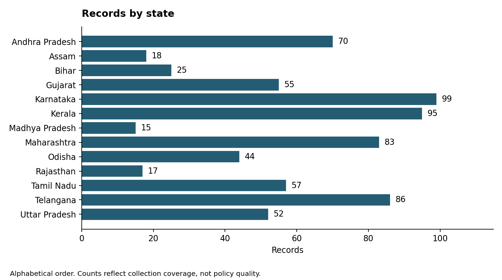
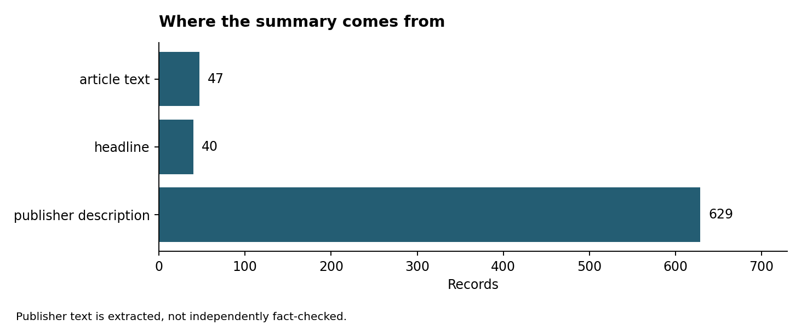
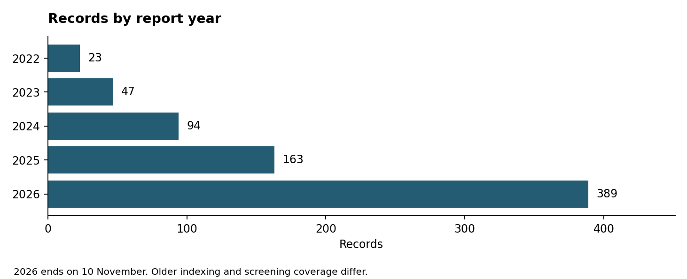

# Work Test Submission SAFL Vishnu Kosuri

## What I set out to build

I wanted a tracker where the collection and filtering decisions can be checked. A reader should be able to open a record, see the report behind it, and understand why several reports became one event. The work focuses on collection, state and date handling, deduplication, and the limits of what the resulting data can establish.

The release contains **716 records across thirteen states**, from 1 January 2022 to 10 November 2026. It includes 1,306 contributing reports and 17,253 dropped items with reasons. The final correction on 11 November separated two reversals that the earlier 714-record build had merged. No original records were removed.

[Submission folder](https://drive.google.com/drive/folders/1eiXw9zKOpTp3EN4HnGmL0P7h-ZHP8095) | [Dashboard](https://vishnu0906.github.io/state-ai-policy-tracker/) | [Trends](https://vishnu0906.github.io/state-ai-policy-tracker/trends.html) | [Repository](https://github.com/VISHNU0906/state-ai-policy-tracker) | [Dataset on Hugging Face](https://huggingface.co/datasets/VKO34/INDIAN-STATE-WISE-AI-POLICY) | [Direct CSV](https://vishnu0906.github.io/state-ai-policy-tracker/data/records.csv)

The folder contains the dataset and workbook, code ZIP, Git history, method, one-page rationale, research appendix, charts and verification results. The source project and website use the same exported tables.

## What the dataset represents

An event is a concrete reported step involving AI and a government actor. That can be a policy announcement, a signed agreement, a budget provision, an institution, a public-service application or a rule. A proposal, an approval and a launch are different stages. A cancellation is a new event, even if its headline repeats the original agreement.

The selected states are Andhra Pradesh, Assam, Bihar, Gujarat, Karnataka, Kerala, Madhya Pradesh, Maharashtra, Odisha, Rajasthan, Tamil Nadu, Telangana and Uttar Pradesh. The initial count sweep used the same query for all twenty-eight states and kept geographical variation in the selection. Andhra Pradesh, Madhya Pradesh and Rajasthan were then added for comparison with a separate reference collection. This is a selected sample, not a census.

The dataset labels state, local, judiciary and central actions separately. Seven central-government records are included because they concern a named state. They can be excluded for a state-government-only analysis. Opinion, general statements, private company activity without a government party, party politics and misuse stories without a policy response are excluded.

## Collection and sources

Google News RSS supplies most of the discovery coverage. It is free, accepts state and date terms, and indexes national and regional English reporting. Four query shapes cover government actors, policy instruments, public services, and infrastructure or regulation. They run by state and calendar month. Overlap is deliberate because different headlines describe the same action in different terms.

The stored Google collection has 3,068 query responses and 36,855 hits. No Google response reached the collector's 100-item warning threshold. GDELT contributed 896 hits but much of its run failed or was skipped. Bing contributed 172 recent hits. The replay records 391 failed or skipped attempts across sources. These gaps remain visible in the logs.

GNews.io, NewsAPI.org and NewsData.io adapters are included but were not tested with live keys. Tavily extraction is an optional fallback and was not used in the original run. Exa, Firecrawl and Crustdata are not integrated in this repository. The release does not depend on paid access. I would test an additional provider on the same query set before treating it as reliable redundancy: useful new records, failed requests and cost per retained event matter more than the number of connected services.

Raw discovery responses and short page extracts are cached. The page reader resolves the representative publisher link and extracts a description or lead with trafilatura. It tries up to three reports in a cluster when a page fails. Offline mode now explicitly avoids network and optional model calls, including when a page is missing from the cache.

## State and date handling

The state comes from the headline, then the description if the headline contains no state. It is not assigned from the query. Full names, aliases, common spelling errors and capitals are recognised. Uttar Pradesh, Uttar-Pradesh, UttarPradesh, UP and U.P. resolve to one name. Ambiguous abbreviations need context: MP next to a government word can mean Madhya Pradesh; Congress MP should not.

Long misspellings can be matched by a similarity rule. This increases coverage but can make mistakes, so it is not a substitute for checking difficult cases. City names have lower weight than state names. Union territories are recognised but excluded from this release.

Dates are converted to ISO format. Timestamped feeds are converted to India time before taking the day. Month, quarter and year inputs keep their precision even though storage uses the first day of the period. An unparseable date is empty. If neither the feed nor URL supplies a usable date, the item goes to the rejection log as no_date.

The parser handles named months, common month misspellings, ordinal suffixes, two-digit years and relative expressions with a supplied reference date. Numeric dates use a documented day-first assumption. Naive timestamps are treated as UTC. Relative hours and week expressions have known limitations because the parser receives a date rather than a full reference timestamp; the method note lists these. None of those loose-date paths was needed for the published feed timestamps.

All 716 records have day precision. That is the precision of the report timestamp. It does not establish the day the government acted. The record date is the earliest report in its cluster. A separate official order may give a different action date.

## How duplicates are handled

Collection first collapses repeated source items. Event matching then compares headlines attributed to the same state within five days. It removes common words, maps a small synonym list, keeps number tokens and gives rare shared words more weight. The similarity score is the average of weighted cosine and weighted overlap. The threshold is 0.25, increasing by 0.08 for each day beyond the first.

Linked pairs form a cluster. A typical headline is chosen as the representative, with outlet preference and report time breaking ties. The earliest report supplies the record date and ID seed. Every retained report stays in record_sources.csv, so a reviewer can inspect the group rather than just its representative.

The final check found that the reversal expression contained literal control characters instead of word boundaries. It also found that identical URLs could bypass state and reversal checks. Both are repaired. Regression tests now keep cancellations separate even when a publisher reuses a URL. This separated the Puch AI cancellation in Uttar Pradesh and the Safe Kerala payment halt, bringing the total from 714 to 716. Their publisher links were resolved and fetched. The payment halt is classified as reversed, not announced.

This remains a rule-based matcher. Reports outside the five-day window can survive as duplicates. Transitive links can join a long chain, and decimal amounts lose precision during tokenisation. A shared headline score does not establish event identity. The correct next check is an independently labelled set with disjoint events across tuning and evaluation, followed by cluster-level review.

## What the checks establish

The release passes 97 tests, including nine added regression cases. The offline build produces the three published CSV tables. The release checks validate required fields, unique record IDs, source links, foreign keys, date order, state names and consistency with the dashboard data. These checks establish structural consistency. They do not establish that every source claim is true.

The saved duplicate-pair file contains 140 assistant-labelled pairs. The current diagnostic finds 136 in the corpus and reports precision 0.96 and recall 1.00 on its reporting half. I would not use those figures as an independent accuracy claim. Thirty-one headlines appear in both halves, and the method was changed after inspecting errors across the set. The earlier approximate reference comparison found 37 of 66 in-scope events, but it used the older 2025-26 snapshot and is not recall for this release.

The review labels have also been corrected. There are 545 historical headline-screening IDs and 171 automatic records. The earlier handoff identifies the screening and pair labels as assistant-produced. No claim is made that I personally read every headline or checked every article. The label records processing history; it does not establish independent human verification.

## Findings and the next evidence needed

The retained report counts are 23 in 2022, 47 in 2023, 94 in 2024, 163 in 2025 and 389 in 2026 through 10 November. The rise is descriptive of this collection. Older indexing, changing press coverage and different screening coverage make a policy-growth estimate unsupported.

Headline rules classify 334 records as announced, 176 as launched, 85 as signed, 57 as approved, four as reversed and sixty as unspecified. These categories describe wording. They do not establish use, spending or benefit. Government deployment is the fallback category for 317 records, so it particularly needs further checking.

The separate 85-event research appendix adds a different kind of evidence. It preserves official-document links, date explanations and limitations across twelve states. It is not merged into the 716 records because the event definitions and dates differ. Its useful contribution is the distinction between an announcement, a formal instrument and evidence of execution.

For example, Rajasthan's GPU-server request for proposals is dated 24 March 2026 and specifies procurement requirements. It establishes a procurement step, not installed capacity. The appendix records separate Odisha policy approval and Gazette-publication milestones; that distinction would disappear if every milestone inherited a newspaper date. Its Tamil Nadu mission record points to a government order, which is a different evidentiary object from a general mission headline. The Odisha and Tamil Nadu links timed out during the final access check; the inherited source notes remain attached and these examples are not presented as newly reverified.

The two recovered reversal cases show why stage matters. Reporting places the UP agreement on 23 March 2026 and the cancellation decision on 26 March; the tracker retains the report date of 27 March. The Kerala court payment halt is reported on 21 June 2023, while the report describes the preceding day's order. Neither belongs in a count of uninterrupted delivery.

I would next look for award and acceptance records behind tenders, completion counts behind training targets, and usage or evaluation results behind service launches. Budget provisions, private investment promises and expenditure should remain separate. More news sources can improve discovery, but those follow-up documents are what let the tracker say something useful about implementation.

Sources for these examples: [Rajasthan RFP](https://risl.rajasthan.gov.in/uploads/tenders/924cfd3d-e99e-42e1-ac75-ec0be93851ad.pdf), [Odisha Gazette](https://egazette.odisha.gov.in/Archival_ControllerEW/download_gazette/5343), [Tamil Nadu mission order](https://cms.tn.gov.in/cms_migrated/document/GO/it_e_25_2024_Ms.pdf), [UP cancellation report](https://www.newindianexpress.com/states/uttar-pradesh/2026/Mar/27/up-government-cancels-rs-25000-crore-mou-with-puch-ai-over-financial-concerns), [Kerala court report](https://www.scconline.com/blog/post/2023/06/21/kerala-hc-directs-govt-halt-payment-safe-kerala-project-deals/).

## Reading and reproducing the submission

The Google Drive folder has one current location for each deliverable. Start with this document and the one-page rationale. Open the workbook to inspect records, the data dictionary and exclusions. Use the source table to inspect grouped reports. The method note explains the rules and edge cases; the research appendix contains the document-led findings and original source links.

The code ZIP contains the pipeline, tests and caches. The Git bundle preserves the development history. Follow the README to rebuild offline and serve the static site locally. A weekly GitHub workflow collects recent candidates into a review artifact; it does not silently add them to the published dataset. The dataset card describes the separate tables and the limits on reuse of publisher text.
