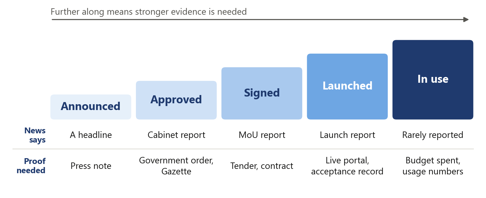

# Work Test Submission SAFL Vishnu Kosuri

## State AI Policy Tracker

A traceable collection of reported government policies across thirteen Indian states.  
Research window: 1 January 2022 to 10 November 2026.

[Dashboard](https://vishnu0906.github.io/state-ai-policy-tracker/) | [Trend charts](https://vishnu0906.github.io/state-ai-policy-tracker/trends.html) | [GitHub repository](https://github.com/VISHNU0906/state-ai-policy-tracker) | [Hugging Face dataset](https://huggingface.co/datasets/VKO34/INDIAN-STATE-WISE-AI-POLICY) | [Dataset CSV](https://vishnu0906.github.io/state-ai-policy-tracker/data/records.csv) | [Submission folder](https://drive.google.com/drive/folders/1eiXw9zKOpTp3EN4HnGmL0P7h-ZHP8095)

## What I built and why

I built this because so many outlets publish the same news. When I see forty headlines about a state and AI, I do not know if that is forty policies or one policy getting approved. Karnataka's AI University announcement in July 2026 came back 39 times in my searches, each time with a different headline.

The tracker has two goals. The first is to count policies, one row for each, and put them out for public review, so anyone can see which states are being more proactive on AI. The second comes later. Once every policy is on record, I can follow each one: how much of it has been implemented, how far it has progressed, and other measures like the money spent. This submission does the first and prepares the ground for the second.

Here a policy means one concrete step by a government that involves AI. It can be a policy document, a new body, a signed agreement, a budget line, a launch or a rule. Every policy keeps the news reports behind it, and every item I dropped is saved with the reason. Anyone can open a row and check my work.

**716** policies | **13** states | **1,306** news reports behind them | **17,253** items dropped, each with a reason

![Figure 1. The live dashboard [1]](docs/figures/report/site_top.png)

*Figure 1. The live dashboard [1]*

## Where news data breaks

News is the fastest way to see what states are doing, but it is messy data. These are the six problems I ran into. Each one shaped a part of the pipeline.

|   | Where it breaks | What I did about it |
| --- | --- | --- |
| 01 | **One policy, many headlines.** The same announcement is reported by many outlets in different words. Counting headlines makes the loudest states look the busiest. | Match headlines on the rare words they share and merge them into one policy. |
| 02 | **A cancellation looks like the original.** "UP signs Rs 25,000 crore MoU with Puch AI" and "UP cancels Rs 25,000 crore MoU with Puch AI" share almost every word. | A report of a cancellation never merges with a report that is not one. |
| 03 | **State names are messy.** UP, U.P., Uttar-Pradesh and Uttar Pradesh are one state. MP can be Madhya Pradesh or a Member of Parliament. | A list of spellings for all 36 states and union territories. Short forms count only next to a government word. |
| 04 | **Dates are loose.** Feeds give the time in UTC. Articles say "last week" or "FY 2025-26". | Convert to India time, store how exact each date is, and never guess a missing one. |
| 05 | **Most AI news is not policy.** Opinion pieces, crime stories, company news. Sometimes AI means Air India. | Keep a report only if it has AI, a government and a concrete step. |
| 06 | **An announcement is not delivery.** A headline tells me what was said, not what was built. | Label how far each policy got, as reported. I do not claim more than that. |

## What the data shows

I first ran the same search for all 28 states and looked at how much came back. I picked the working set from that count and from how the states are spread across the country. I then added Andhra Pradesh, Madhya Pradesh and Rajasthan so I could compare against a separate list of 85 policies collected from official documents. That gave me thirteen states. It is a sample I chose. The counts compare these thirteen states and say nothing yet about the other fifteen.

Figure 2 has the counts. Karnataka (99), Kerala (95) and Telangana (86) have the most policies. Kerala is the interesting one. It has 23 policies in 2023, when most states had fewer than five, and 20 of those 23 are about one project: the AI traffic cameras. The launch, the opposition's questions, the inquiry and the High Court order on payments all came through as separate rows. Some of those are real steps and some are follow-up stories. That taught me a high count can mean one controversial project, not many policies.

![Figure 2. Policies by state and year [2]](docs/figures/report/state_year.png)

*Figure 2. Policies by state and year [2]*

![Figure 3. Policies recorded every half-year [2]](docs/figures/report/halfyear.png)

*Figure 3. Policies recorded every half-year [2]*

The count goes from 23 in 2022 to 389 in 2026, with 2026 only up to 10 November. I think part of that rise is real and part of it comes from the search index, because older news is harder to find. So I would not quote this chart as a growth rate. I use it to decide which periods to look at more closely.

![Figure 4. Category of policy, and how far each one got [2]](docs/figures/report/category_stage.png)

*Figure 4. Category of policy, and how far each one got [2]*

Most of what states do with AI is put it to use. 317 of the 716 policies are deployments in policing, schools, farming and public services. That bar is larger than it should be, because my rules also place a policy there when no other category fits. Only 43 are policy or strategy documents and 22 are rules. Close to half (334) were only announced, and 4 were reversed.

One limit applies to all three charts. I searched English news only. A state with a small count may simply be covered more in Hindi, Telugu or Odia papers that I did not search.

## How a news report becomes a policy

![Figure 5. The pipeline in six steps [3]](docs/figures/report/pipeline_steps.png)

*Figure 5. The pipeline in six steps [3]*

I used Google News RSS as the main source. It is free, it needs no key, and it lets me search by state and by month. For each of the 13 states and each of the 59 months I ran four searches: one on the government itself, one on policy instruments, one on public services and one on infrastructure and rules. That is 3,068 searches. None of them reached the 100-result limit, which was my check that a busy month was not being cut off.

| Source | What came back | Where it stands |
| --- | --- | --- |
| Google News RSS | 3,068 searches, 36,855 results | The main source. Free, and it worked on every search. |
| GDELT | 896 results | Rate limited on most calls, so its coverage is incomplete. |
| Bing News RSS | 172 results | Recent weeks only. |
| Publisher pages | Summaries for 676 of the 716 policies | Read on my own machine with trafilatura. 629 summaries use the publisher's description and 47 use the article text. The other 40 repeat the headline because the site blocked the read. |
| GNews, NewsAPI, NewsData | Nothing yet | The code is written, but I never ran it with a key. I do not count these as sources. |

Every response is saved to disk. The whole dataset can be rebuilt from those saved files with no network and no paid key.

![Figure 6. From search results to policies [3]](docs/figures/report/funnel.png)

*Figure 6. From search results to policies [3]*

The biggest cut is the filter. A news item stays only if it mentions AI, names a government and reports a concrete step. Everything else is dropped, and the reason is written next to it in rejected.csv.

![Figure 7. Why 17,253 items were dropped [2]](docs/figures/report/dropped.png)

*Figure 7. Why 17,253 items were dropped [2]*

## Getting state names and dates right

### State names

A search for Uttar Pradesh can return a story about Bihar. So I never take the state from the search. I read it from the headline, and from the description only when the headline names no state. A full state name beats a city name, and a short form like MP counts only when a government word sits next to it. [4]

| What the news says | What I store | Rule |
| --- | --- | --- |
| Uttar-Pradesh, UttarPradesh, U.P. | Uttar Pradesh | Known spellings, matched as whole words |
| Karnatka, Maharastra, Orissa | Karnataka, Maharashtra, Odisha | Common misspellings and old names, listed by hand |
| MP govt | Madhya Pradesh | A short form next to a government word |
| Congress MP | No state | Here MP is a Member of Parliament |
| Bengaluru, with no state named | Karnataka | A city counts, but less than a state name |
| Tamil Naddu | Tamil Nadu | Close spelling match (0.84 or higher), only for names of six letters or more |

### Dates

The date on each policy is the date of the earliest news report about it, in India time. It is not the date a government order was signed. I kept those two apart on purpose. A news date is something I can check. An order date is something I would be guessing from a headline.

| What comes in | What I store | Why |
| --- | --- | --- |
| 2026-07-07T20:30:00Z | 2026-07-08, exact day | 8:30 pm UTC is already the next day in India |
| 03/04/2026 | 2026-04-03, exact day | India writes the day first |
| Sep 2026 | 2026-09-01, month only | The first of the month is a placeholder, and it is marked as one |
| Q3 2026 | 2026-07-01, quarter only | Same idea, for a quarter |
| FY 2025-26 | 2025-04-01, year only | The financial year starts in April |
| "recently", or no date at all | Dropped | I never fill in the day I collected it |

All 716 policies have an exact day, because the feeds gave timestamps. The rules for vague dates are in the code and tested, but this release did not need them.

## Removing duplicates

This was the hardest part, and I got it wrong twice before it worked.

My first version compared every headline with the first headline in its group. Big stories split into many policies, because no single headline looks like all the others. I changed it to link any two headlines that match and then join the chains. That fixed the splitting and created the opposite problem. A signing and its cancellation four days later became one policy.

This is how it works now. [5]

1. Compare only headlines from the same state that are at most five days apart.
2. Break each headline into words. Drop the common ones and the state name, since every headline in the group has them. Treat words that mean the same thing as one word, so pact, deal and agreement all become MoU.
3. Give rare words more weight. Two headlines that share "Puch" or "25,000" are very likely about the same thing. Two that share "school" may not be.
4. Score the pair. If the score clears the bar, the two reports are the same policy. The bar goes up for every extra day between them.
5. A report of a cancellation is never merged with a report that is not one.

![Figure 8. The matching score [5]](docs/figures/report/formula.png)

*Figure 8. The matching score [5]*

Figure 9 takes two of the 39 reports on the Karnataka AI University. After the common words are removed, headline A has two words left and both are in headline B. The score is 0.76 against a bar of 0.25, so they merge. The weights in the figure are worked out from the 1,306 published headlines.

![Figure 9. A real pair from the dataset [2]](docs/figures/report/worked.png)

*Figure 9. A real pair from the dataset [2]*

![Figure 10. The bar rises as reports get further apart [5]](docs/figures/report/threshold.png)

*Figure 10. The bar rises as reports get further apart [5]*

### The bug found late

The Uttar Pradesh story in Figure 10 is the reason the cancellation rule exists. The signing and the cancellation score 0.82, well above the bar of 0.49 for reports four days apart. Only that rule keeps them apart. The final check before release found two holes in it. The pattern that spots words like "cancels" and "scraps" had broken characters in it, and reports that shared a link skipped the check completely. Fixing both separated two policies that had been merged, and the total went from 714 to 716. [7]

| Policy | Date of the report | What happened |
| --- | --- | --- |
| Uttar Pradesh cancels the Puch AI MoU | 27 March 2026 | The MoU was signed on 23 March and cancelled on 26 March. These are now two policies, one signed and one reversed. |
| Kerala High Court halts payments for the AI cameras | 21 June 2023 | The court order came the day before the report. It is now its own policy, marked reversed. |

Some things can still go wrong. A running story can chain into one policy if each report resembles the next. A report that comes more than five days later stays separate. Two different policies from one state in the same week, announced in similar words, can merge.

As the saying goes, prevention is ideal but detection is a must. I could not prevent every wrong merge, so I made sure each one can be detected. Every report behind a policy is listed in record_sources.csv, and a wrong merge shows up as soon as someone reads that list.

## How I checked it

![Figure 11. Precision and recall as the bar moves [6]](docs/figures/report/precision_recall.png)

*Figure 11. Precision and recall as the bar moves [6]*

I set the bar at 0.25 using 140 headline pairs labelled as same policy or different policy. Figure 11 shows why. It is the highest bar that still finds every labelled duplicate. Raise it and real duplicates start to slip through as separate policies. Lower it and different policies start to merge.

| Check | Result | What it tells me |
| --- | --- | --- |
| Automated tests | 97 pass | The rules do what I wrote them to do. They cannot tell me whether a news article is true. |
| Rebuild from the saved files | Same rows and values in the CSV files | Anyone can reproduce the dataset without a network. |
| 140 labelled headline pairs | 136 found in the data. Precision 0.96, recall 1.00 | Useful for tuning. It is not an independent score, for the reason below. |
| Screening of headlines | 545 policies screened, 171 not | The 171 are mostly from 2022 to 2024. Kerala in 2023 shows what unscreened rows look like. |

I should be clear about how the screening was done. I used an AI assistant to go through the headlines, mark the ones that did not belong and label the duplicate pairs. I did not open and read every article myself. The same labelled pairs were also used to set the threshold, so 0.96 is a development number and I would not quote it as accuracy.

Every policy links straight to the publisher. In the list of supporting reports, 1,206 of the 1,306 links still go through a Google News redirect, which I have not resolved yet.

## The dashboard

I kept the page simple. The big numbers and the growth chart come first. Below them, filters for state, category of policy, sector and level of government narrow the list, and a grid of states and months shows when things happened. Every policy opens the news reports behind it. A separate page has the trend charts for 2022 to 2026.

![Figure 12. Filters and the state by month grid [1]](docs/figures/report/site_grid.png)

*Figure 12. Filters and the state by month grid [1]*

### Run it yourself

You need Python 3.11 or later. The saved responses are in the repository, so this needs no API key. [3]

```powershell
python -m pip install -r requirements.txt
python -m pytest -q
$env:PIPELINE_OFFLINE = "1"
python -m pipeline.collect
python -m pipeline.build
python -m scripts.validate_release
python -m http.server 8790 --directory docs
```

The first two lines install and test. The next four rebuild the dataset from the saved responses and check it. The last one serves the dashboard at localhost:8790. These are PowerShell commands.

## What is in the folder

| What | Where |
| --- | --- |
| This document | 01_Submission: Google Doc, Word and PDF |
| Dataset | 02_Dataset: records.csv, records.xlsx, record_sources.csv, rejected.csv, tracker.sqlite |
| Code and commit history | 03_Code: zip of the repository, with the saved responses. 04_Git_History: Git bundle |
| Rationale and method | 05_Method_and_Research: one-page rationale, README, methodology, research notes |
| Checks and figures | 06_Verification_and_Figures: test and validation output, chart images |

## What comes next

The whole goal is to move from what was announced to what was implemented. Honestly, the main thing I would do differently is start from official documents sooner. News tells me something was announced. A government order, a tender or a budget line tells me it happened. The further along a policy is, the less the news says about it.



*Figure 13. What the news says, and what proof is needed*

I have a small start on this. A separate list of 85 policies from official documents sits in the research folder. One example is Rajasthan's tender for GPU servers, dated 24 March 2026. It proves the state asked for bids. It does not prove the servers were installed. I kept that list apart from the 716 because it follows different rules and the two overlap. [8]

With more time, I would do these in order.

1. Follow each policy after the announcement and record its progress: order issued, tender awarded, launched, in use.
2. Add government orders, tenders and budgets, each with its own date, so progress is measured and not guessed.
3. Have a person review a fixed sample of whole policies, kept away from anything used for tuning.
4. Search in Hindi, Telugu, Tamil, Kannada, Malayalam and the other state languages.
5. Run the paid news APIs on the same searches, and keep only the ones that find policies Google News missed.
6. Go from thirteen states to all 28.

## Sources

[[1] Live dashboard and trend charts](https://vishnu0906.github.io/state-ai-policy-tracker/trends.html). Screenshots taken on 11 November 2026.  
[[2] Published dataset](https://github.com/VISHNU0906/state-ai-policy-tracker/tree/main/data/out). 716 policies, 1,306 news reports and 17,253 dropped items.  
[[3] README](https://github.com/VISHNU0906/state-ai-policy-tracker/blob/main/README.md). Sources, saved responses and the commands to rebuild.  
[[4] Methodology](https://github.com/VISHNU0906/state-ai-policy-tracker/blob/main/METHODOLOGY.md). State and date rules, with examples.  
[[5] Duplicate matching code](https://github.com/VISHNU0906/state-ai-policy-tracker/blob/main/pipeline/dedupe.py). Word weights, the score, the cancellation rule and grouping.  
[[6] Labelled pairs check](https://github.com/VISHNU0906/state-ai-policy-tracker/blob/main/reports/dedup_diagnostic.txt). Precision and recall on 140 labelled headline pairs.  
[[7] Release notes](https://github.com/VISHNU0906/state-ai-policy-tracker/blob/main/RELEASE_NOTES.md). The two wrong merges and how they were fixed.  
[[8] Research notes from official documents](https://github.com/VISHNU0906/state-ai-policy-tracker/blob/main/research/RESEARCH_FINDINGS.md). 85 policies with links to orders, tenders and gazette notices.  
